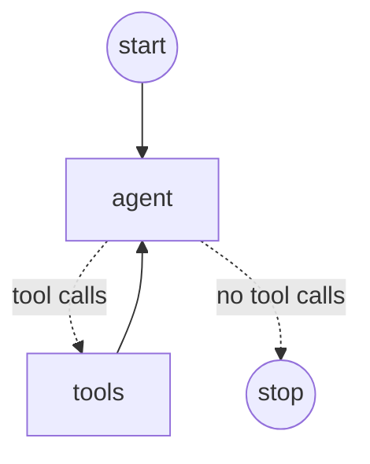

# LangGraph4j + Spring AI OpenAI Example

A minimal Spring Boot application where LangGraph4j routes a user message
through a graph node that calls an OpenAI chat model using Spring AI.

## Requirements

- Java 17 or later
- Maven 3.6 or later
- An OpenAI API key

## Configure and run

Set your key in the current PowerShell session (do not commit it):

```powershell
$env:OPENAI_API_KEY = "your-openai-api-key"
```

Start the application:

```powershell
mvn spring-boot:run
```

The default model is `gpt-4o-mini`. Send a message to the graph:

```powershell
curl.exe -X POST http://localhost:8080/chat `
  -H "Content-Type: application/json" `
  -d '{ "message": "Explain LangGraph in one sentence." }'
```

The response contains the model-generated answer:

```json
{"response":"..."}
```

The `/chat` controller passes the input to the compiled LangGraph4j graph. Its
`chat` node uses Spring AI's `ChatClient` to call OpenAI and returns the
response from the graph's state.

## Tool-calling agent example

`AgentGraph` is a second graph that shows the most common LangGraph pattern,
an agent that loops between the model and its tools:



- `agent` sends the conversation to OpenAI with the tools from `AgentTools`.
  Spring AI's own tool execution is turned off, so the graph decides what
  happens next.
- The conditional edge goes to `tools` when the reply contains tool calls,
  otherwise to `END`.
- `tools` runs each requested tool and adds the results to the conversation,
  then loops back to `agent`.

`AgentTools` has `getWeather` (fake data for Chennai, London and New York) and
`getCurrentTime`. Try it:

```powershell
curl.exe -X POST http://localhost:8080/agent `
  -H "Content-Type: application/json" `
  -d '{ "message": "What is the weather in Chennai and the time there?" }'
```

Print the graph as Mermaid, generated by LangGraph4j itself:

```powershell
curl.exe http://localhost:8080/agent/graph
```

## Test

```powershell
mvn test
```

The tests mock `ChatClient` and `ChatModel`, so they do not make paid OpenAI API
requests. `AgentGraphTest` scripts a tool call followed by a final answer to
exercise the agent loop.
