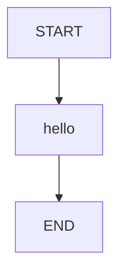

# Learn LangGraph4j: Your First Graph

A small Java program that greets a name using a one-node graph. It does not
depend on the Spring Boot application or require an API key.

From the repository root, run:

```powershell
mvn -f standalone/pom.xml compile exec:java
```

Expected output:

```text
Hello, LangGraph!
```

The graph has one path:

`START -> greet -> END`

- **State** is the data the graph carries. Here, the input state contains
  `name: "LangGraph"`.
- **Node** is a step that reads state and returns updates. The `greet` node
  reads `name` and adds `message: "Hello, LangGraph!"`.
- **Edges** connect steps. They say to run `greet` after `START`, then finish
  after `greet`.
- **Compile** prepares the graph to run.
- **Invoke** runs it with the input state. The program then prints the
  `message` from the final state.

The `greet` method is the node's logic. Try changing the input name or greeting
to see how the state flows through the graph.

## Graph with a hello node

`StartEndLangGraph.java` adds one `hello` node between `START` and `END`. The
node puts a greeting in the graph state, and the program prints that greeting
followed by a Mermaid diagram. It also creates a PNG image of the graph.

Run it from the repository root:

```powershell
mvn -f standalone/pom.xml compile exec:java -Dexec.mainClass=com.example.standalone.StartEndLangGraph
```

The graph path is:

```text
START -> hello -> END
```

The image is saved as `standalone/start-end-graph.png` when you run the command
from the repository root. Open that PNG to see the graph as an image.

To see the graph as a picture, open this README in VS Code and choose
**Markdown: Open Preview** (`Ctrl+Shift+V`). The preview renders this Mermaid
diagram; the Java console prints diagram text because it cannot display images.



## Graph with a few steps between START and END

`StartToEndLangGraph.java` has two nodes. The first creates a greeting, and
the second adds a friendly closing. Each node reads and updates the graph state.
The program prints the final message and the graph diagram.

Run it from the repository root:

```powershell
mvn -f standalone/pom.xml compile exec:java -Dexec.mainClass=com.example.standalone.StartToEndLangGraph
```

The graph path is `START -> greet -> addClosing -> END`.
